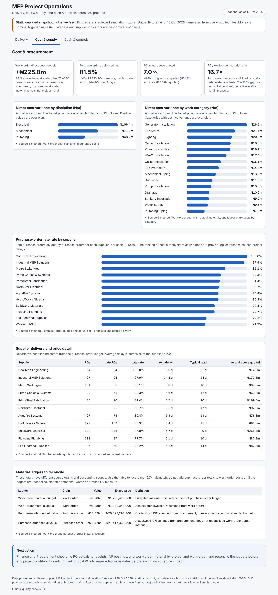
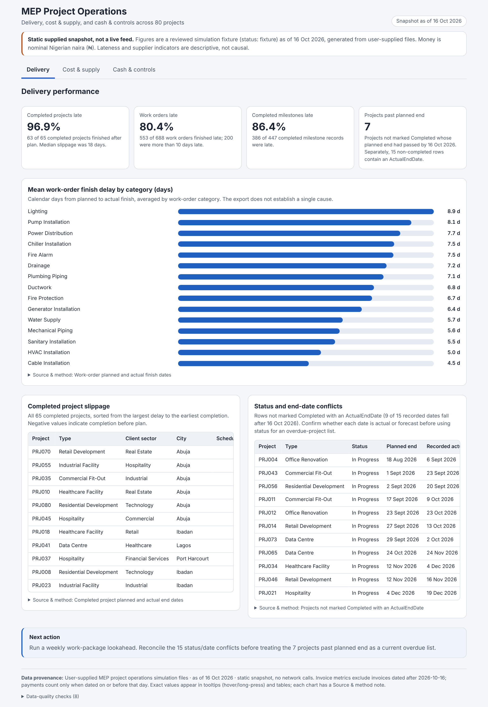
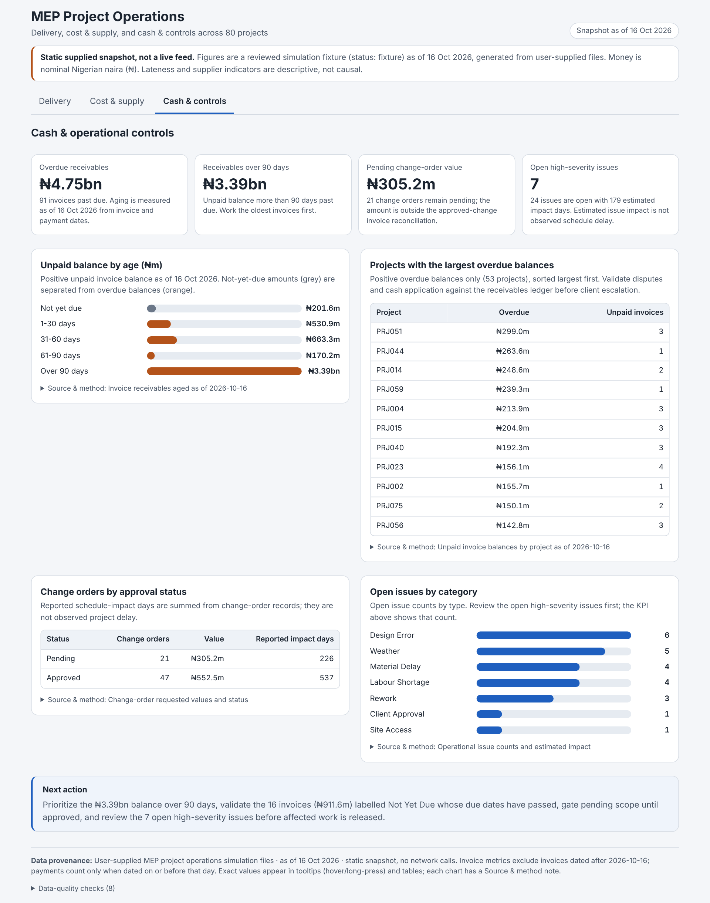

# MEP Project Cost Analysis

**A simulated case study.** Apex MEP Services Ltd., its projects, suppliers, clients and every figure below are fictional. The data comes from a Project Operations Analyst simulation and contains intentional data-quality issues. None of it describes a real company.



*Cost & supply page of the dashboard. Static snapshot as of 16 Oct 2026, not a live feed. The dashboard is `assets/index.html`: one offline file, open it in a browser.*

| | |
|---|---|
| Role simulated | Project Operations Analyst, reporting to the Head of Operations |
| Currency | Nigerian naira (₦), nominal |
| Scope | 80 projects, 688 work orders, 1,350 purchase orders, 12 suppliers |
| Tools | Excel (Power Query, PivotTables, calculated column), a static HTML dashboard |

---

## 1. The decision and problem

The stakeholder wanted to know what is actually happening across a portfolio of concurrent projects, what is driving it, and where management should look first. He did not want "another dashboard full of numbers."

The calculations in the workbook address the cost side of that request:

- Where are material and procurement costs running above plan?
- Is the overrun concentrated in a few projects, or spread across the portfolio?
- Can the figures be trusted well enough to rank projects by profitability?

## 2. Data and what I built

11 CSV tables: projects, work orders, labour entries, procurement (purchase orders), suppliers, change orders, invoices, milestones, issues, employees and clients. They were loaded into `analysis/MEP.xlsx` through Power Query and sit in the workbook as hidden sheets.

**What I built in the workbook:**

- Imported the tables with Power Query and built four PivotTables over them.
- Added a calculated column, `PO Cost Difference` (actual minus quoted cost), to all 1,350 purchase orders. That table sits on the sheet named `PRJ038 table`, although it holds every PO, not just PRJ038's.
- Wrote the **Calculations** sheet:
  - A portfolio KPI row: contract value, approved budget, budgeted vs actual material cost with variance and variance %, and purchase-order actual vs quoted cost.
  - A ranking of the five projects with the largest material overruns.
  - A drill-down of the top project (PRJ038) by discipline and work category, set beside its 27 purchase orders.

**The dashboard.** I generated `assets/index.html` with Claude (an AI assistant). It reads a reviewed data snapshot (`data.json`) and covers delivery, cost and supply, and cash and controls.

## 3. How I checked the work, and what the dashboard helps review

**Checks I ran against the workbook** (recomputed from the raw sheets):

| Check | Result |
|---|---|
| Portfolio KPIs on the Calculations sheet vs recomputed totals | All match: 80 projects, budgeted material ₦1,200,410,000, actual ₦1,280,343,000, PO actual ₦21,417,365,400 |
| Top-5 project ranking | Reproduced exactly; PRJ076 is sixth |
| PRJ038 drill-down | Work-category variances sum to ₦2,191,000; the 27 PO differences sum to ₦25,438,800 |
| Duplicate PO IDs | None in 1,350 rows |
| `QuotedCostNGN` = quantity × quoted unit cost | Holds on every row |
| PO project vs its work order's project | Agree on every row |
| Missing values in procurement | None |

**Checks recorded in the dashboard's data snapshot:**

- No duplicate keys or orphan foreign keys across the 11 tables.
- 685 of 688 work orders differ by more than 10% between PO actuals and work-order material actuals.
- 15 projects not marked Completed carry an `ActualEndDate`.
- 33 milestones marked Pending carry an `ActualDate`.
- 16 invoices marked "Not Yet Due" have due dates that have already passed (₦911.6m).

I documented these rather than correcting them.

**One discrepancy I found and have not resolved:** the workbook's PO quoted total is ₦20,023,165,100, while the dashboard snapshot shows ₦20,023,298,300, a ₦133,200 difference. Both round to ₦20.02bn quoted and a ₦1.39bn / 7.0% uplift, so no conclusion changes, but exact figures differ by that amount between the two artefacts.

**What the dashboard helps a reviewer do:**

- See the headline numbers and drill into the tables behind them. Exact ₦ values appear in tooltips and tables.
- Open "Source & method" on any card to see its definition and files.
- Read the data-quality checks in the footer.
- See explicitly which indicators are descriptive only (supplier and project lateness) and which one is a reconciliation exception (the 16.7× material gap).

## 4. Findings and recommendations

### Findings I can support from the workbook

1. **Work-order material cost is over budget everywhere.** Actual ₦1.280bn vs budget ₦1.200bn: **+₦79.9m (+6.7%)**. All 80 projects are above their material budget. The five largest overruns (PRJ038, PRJ004, PRJ064, PRJ042, PRJ001, ₦1.76m to ₦2.19m each, 8.8% to 12.7% over) add up to ₦9.4m, only about 12% of the total. The overrun is spread across the portfolio, not driven by a few outliers.
2. **Inside PRJ038, the overrun sits mainly in Mechanical and Plumbing.** HVAC installation is +₦668k (18.2%), chiller installation +₦374k (16.6%), sanitary installation +₦404k (16.5%) and drainage +₦361k (16.5%). Mechanical accounts for about half of the ₦2.19m. Fire alarm (−₦67k) and water supply (−₦72k) are under budget. This is one project and does not generalise.
3. **Purchase orders cost more than quoted.** Actual ₦21.42bn vs quoted ₦20.02bn: **+₦1.39bn (+7.0%)**. 1,099 of 1,350 POs (81.4%) came in above quote and 251 below.
4. **The two material ledgers do not reconcile.** PO actuals are **16.7×** the work-order material actuals (₦21.42bn vs ₦1.28bn). Example: PRJ038's 27 POs total ₦385.7m actual against ₦22.2m of work-order material, about 17×. The two ledgers also rank projects differently: PRJ038 is first on work-order material variance but 12th on PO variance (PRJ001 is first at ₦38.4m).
5. **Late delivery is widespread across suppliers.** 1,100 of 1,350 POs (81.5%) were late, with a 9-day median delay among the late ones. Every one of the 12 suppliers has a late rate of at least 71%. CoolTech Engineering is late on all 84 POs, and Industrial MEP Solutions on 95 of 97. BuildCore Materials, the largest supplier by PO count (302), has the largest actual-above-quote amount (₦265.3m).

### Recommendations

Owners are suggestions; the simulation does not say who owns what.

| # | Action | Suggested owner | Metric to monitor |
|---|---|---|---|
| 1 | Reconcile PO actuals to work-order material by project and work order (receipts, AP postings) **before** any project profitability ranking | Finance with Procurement | Share of work orders where PO actual and work-order actual agree within ±10% (today: 3 of 688) |
| 2 | Review how material budgets are set, since all 80 projects overrun | Estimating / Commercial | Material variance % per project, tracked per quarter |
| 3 | Review how promised delivery dates are agreed, starting with the suppliers with the highest late rates | Procurement | Late-PO rate and median delay in days |
| 4 | Review quote-to-actual price differences on the largest suppliers by amount | Procurement | PO actual vs quoted variance %, by supplier |

---

## Repository contents

```
README.md
assets/                     Dashboard screenshots
data/csv                    11 source tables
doc/                        project-brief
analysis/                   Excel workbook (hidden sheets hold the 11 source tables)
```




